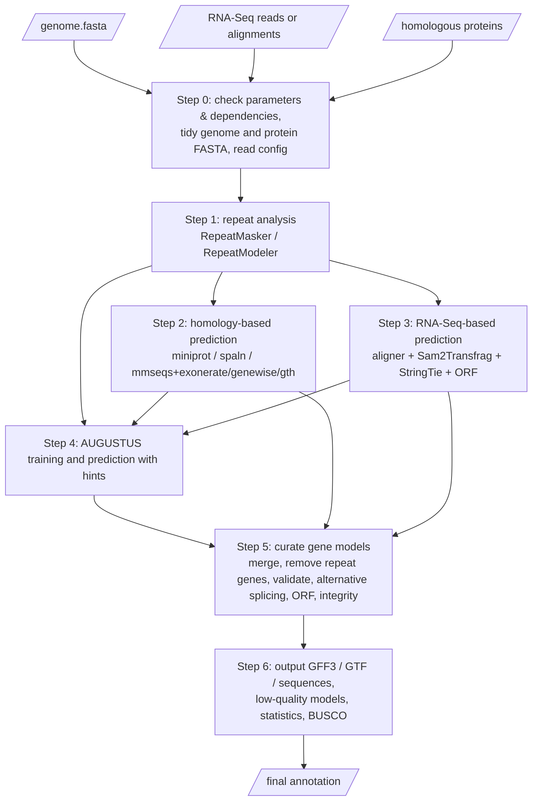

<div align="center">

# GETA

**G**enome-wide **E**lectronic **T**ool for **A**nnotation

*One command from genome + RNA-Seq + homologous proteins to an accurate GFF3 gene annotation.*

[](https://www.gnu.org/licenses/gpl-3.0)


</div>

---

## Table of Contents

- [Introduction](#introduction)
- [Key Features](#key-features)
- [Workflow](#workflow)
- [Installation](#installation)
  - [Dependencies](#dependencies)
  - [Install GETA](#install-geta)
  - [Environment setup](#environment-setup)
- [Quick Start](#quick-start)
- [Usage of the Main Script `geta.pl`](#usage-of-the-main-script-getapl)
  - [Input options](#input-options)
  - [Repeat analysis options](#repeat-analysis-options)
  - [Gene prediction options](#gene-prediction-options)
  - [Gene model integration and filtering options](#gene-model-integration-and-filtering-options)
  - [Output options](#output-options)
  - [Running and help options](#running-and-help-options)
- [Typical Command Lines](#typical-command-lines)
- [Configuration File (`config.txt`)](#configuration-file-configtxt)
- [Output Files](#output-files)
- [Temporary Directory and Resuming a Run](#temporary-directory-and-resuming-a-run)
- [Sub-programs](#sub-programs)
- [Tips and Best Practices](#tips-and-best-practices)
- [Troubleshooting / FAQ](#troubleshooting--faq)
- [Testing and Accuracy](#testing-and-accuracy)
- [Contributing](#contributing)
- [Authors](#authors)
- [License](#license)

---

## Introduction

**GETA** (Genome-wide Electronic Tool for Annotation) is a pipeline for predicting gene models in eukaryotic genome sequences. Provide the genome sequence, RNA-Seq data and/or the whole-genome protein sequences of closely related species, and GETA produces a ready-to-use annotation in GFF3 format with a **single command**.

GETA integrates three independent lines of evidence — **homologous proteins**, **RNA-Seq transcripts** and **ab initio prediction by AUGUSTUS trained on the evidence** — and then curates the merged result (repeat filtering, HMM/BLASTP validation, alternative splicing, ORF analysis and integrity checks) to obtain the final gene models.

## Key Features

- **Accurate prediction** – the number of predicted genes is realistic, BUSCO completeness is high and exon boundaries are accurate.
- **Simple to run** – one command runs the whole pipeline automatically; an interrupted run is resumed by simply re-running the same command.
- **Multiple lines of evidence** – homologous proteins (up to five methods), RNA-Seq (FASTQ / SAM / BAM / CRAM, paired-end and/or single-end, optional strand-specific), and AUGUSTUS with hints.
- **Five homology-based methods** – `miniprot` (default), `spaln`, `exonerate`, `genewise`, `gth`, usable alone or in any combination. Results of all methods are merged, classified (A/B/C/D) and filtered by `Supported_times`.
- **Repeat handling built in** – RepeatMasker (Dfam and/or RepBase), RepeatModeler, or a user-supplied repeat library, with a built-in fork-based parallel RepeatMasker worker pool.
- **Gene-model validation** – Pfam-like HMM databases (`hmmscan`) and/or diamond protein databases are used to validate unreliable gene models.
- **Alternative splicing** – isoforms are added from RNA-Seq intron and base-depth information, followed by ORF analysis.
- **Rich statistics** – a `*.gene_prediction.summary` file traces the reliability of every step; optional BUSCO assessment of the final result and of every raw prediction, so the methods can be compared.
- **Genetic code support** – NCBI genetic code tables 1–6, 9–16 and 21–33.
- **Fully configurable** – parameters of every sub-program can be tuned in a well-commented configuration file.
- **Bilingual help** – `--help` (English) and `--chinese_help` (中文).

## Workflow



| Step | Program | What it does |
|------|---------|--------------|
| 0 | `geta.pl` | Checks parameters, dependent software and sub-programs; tidies the genome (`genome_seq_clear.pl`) and protein (`fasta_format_revising.pl`) FASTA files; reads the configuration file. |
| 1 | `runRepeatMaskerModeler` | RepeatMasker (Dfam / RepBase / `--RM_lib`) and RepeatModeler; produces the repeat annotation and the repeat-masked genome. Skipped when only `--no_RepeatModeler` is set. |
| 2 | `homolog_prediction` | Predicts gene models from homologous proteins; classifies them into A/B/C/D and filters low-confidence ones. |
| 3 | `NGSReads_prediction` | Aligns RNA-Seq reads, assembles transcripts (Sam2Transfrag + StringTie), predicts ORFs (TIdeS or TransDecoder); also outputs reliable introns and base depth. |
| 4 | `runAugustus` | Trains AUGUSTUS with the evidence gene models, generates hints and predicts genes genome-wide. |
| 5 | `curateGeneModels` | Merges the three predictions, removes genes in transposable elements, validates unreliable genes (HMM/BLASTP), adds alternative splicing, performs ORF analysis, removes incomplete transcripts. |
| 6 | `outputResults` | Writes GFF3/GTF/sequence files, low-quality models, repeat annotation, raw predictions, optional BUSCO results and the summary statistics. |

## Installation

### Dependencies

GETA was tested on **Rocky Linux 9.2**. Perl (≥ 5.10) with the core modules `Getopt::Long`, `File::Basename`, `File::Path`, `File::Spec`, `File::Copy`, `Cwd`, `POSIX`, `Digest::MD5` and `Fcntl` is required (all are part of a standard Perl installation). **ParaFly and GNU parallel are no longer required**: parallelisation is implemented inside the Perl scripts.

The dependent software are listed in the order in which the pipeline calls them. Most of them are needed **only if the corresponding option is used** — `geta.pl` checks everything it needs once at start-up and lists all missing items before any computation begins.

| # | Software | Tested version | Required when |
|---|----------|----------------|---------------|
| 01 | [RepeatMasker](https://www.repeatmasker.org/) | 4.1.6 | Repeat analysis (Step 1) |
| 02 | [HMMER](http://hmmer.org/) (`nhmmer`, `hmmscan`) | 3.3.2 | `nhmmer`: `--RM_species_Dfam`; `hmmscan`: `--HMM_db` |
| 03 | makeblastdb / [rmblastn](https://www.repeatmasker.org/rmblast/) | 2.14.0 | `--RM_species_RepBase`, `--RM_lib`, or RepeatModeler |
| 04 | [RepeatModeler](https://github.com/Dfam-consortium/RepeatModeler) | 2.0.5 | Neither `--RM_lib` nor `--no_RepeatModeler` is set |
| 05 | [MMseqs2](https://github.com/soedinglab/MMseqs2) | 15-6f452 | `--homolog_prediction_method` includes `gth`, `exonerate` or `genewise` |
| 06 | [GenomeThreader](https://genomethreader.org/) (`gth`) | 1.7.3 | method `gth` |
| 07 | [exonerate](https://www.ebi.ac.uk/about/vertebrate-genomics/software/exonerate) | 2.2.0 | method `exonerate` |
| 08 | [GeneWise](https://www.ebi.ac.uk/Tools/psa/genewise/) | 2.4.1 | method `genewise` |
| 09 | [miniprot](https://github.com/lh3/miniprot) | 0.18 | method `miniprot` (default) |
| 10 | [spaln](https://github.com/ogotoh/spaln) | 3.0.9 | method `spaln` |
| 11 | Java | jdk-20.0.1 | FASTQ input (runs the bundled Trimmomatic-0.38) |
| 12 | [STAR](https://github.com/alexdobin/STAR) | 2.7.11b | FASTQ input with the default aligner |
| 13 | [HISAT2](https://daehwankimlab.github.io/hisat2/) | 2.1.0 | FASTQ input with `--aligner hisat2` (`hisat2` and `hisat2-build`) |
| 14 | [SAMtools](https://www.htslib.org/) | 1.17 | Any RNA-Seq input |
| 15 | [StringTie](https://ccb.jhu.edu/software/stringtie/) | 2.1.3 | Any RNA-Seq input |
| 16 | TIdeS (`tides.py` / `tides`) | 1.0.0 | RNA-Seq input **and** `--protein` (ORF prediction); otherwise the bundled TransDecoder-v5.5.0 is used |
| 17 | [DIAMOND](https://github.com/bbuchfink/diamond) | 2.1.8 | Always (picking evidence gene models, BLASTP validation, TIdeS) |
| 18 | [CD-HIT](https://sites.google.com/view/cd-hit) | 4.8.1 | TIdeS dependency |
| 19 | [Barrnap](https://github.com/tseemann/barrnap) | 1.10.5 | TIdeS dependency |
| 20 | [AUGUSTUS](https://github.com/Gaius-Augustus/Augustus) (`augustus`, `etraining`, `optimize_augustus.pl`, `new_species.pl`, `gff2gbSmallDNA.pl`, `filterGenes.pl`, `randomSplit.pl`) | 3.5.0 | Always (Step 4) |
| 21 | [BUSCO](https://busco.ezlab.org/) | 5.4.7 | `--BUSCO_lineage_dataset` |

Bundled with GETA (placed in the installation directory, no separate installation needed): **Trimmomatic-0.38**, **TransDecoder-v5.5.0** (modified version), `RepeatMasker_lineage.txt` and `BUSCO_lineages_list.2021-12-14.txt`.

> **Note on Dfam:** RepeatMasker ships only partition 0 (root) of the Dfam database, which suits mammals and fungi. For plants, install partition 5 (*Viridiplantae*); for Hymenoptera, partition 7. Install the partition that matches your species when using `--RM_species_Dfam`.

### Install GETA

```bash
# 1. Unpack (or clone) GETA into the installation directory, e.g. /opt/biosoft/geta
git clone https://github.com/chenlianfu/geta.git /opt/biosoft/geta
# or: tar -zxf geta.tar.gz -C /opt/biosoft/

# 2. Make sure the programs in bin/ are executable
chmod +x /opt/biosoft/geta/bin/*

# 3. Install the dependent software (see the table above and the INSTALL file),
#    and add their directories to PATH
```

Detailed command lines for installing all dependent software and GETA are given in the [`INSTALL`](INSTALL) file.

### Environment setup

```bash
# Add GETA to PATH (optional – geta.pl can also be called with its full path)
export PATH=/opt/biosoft/geta/bin:$PATH

# AUGUSTUS needs its configuration directory (must contain a "species" sub-directory)
export AUGUSTUS_CONFIG_PATH=/opt/biosoft/augustus/config
```

> **Important:** the sub-programs in `bin/` (`runRepeatMaskerModeler`, `homolog_prediction`, `NGSReads_prediction`, `runAugustus`, `curateGeneModels`, `outputResults`, `GFF3Clear`, `genome_seq_clear.pl`, `fasta_format_revising.pl`, `gff3_to_sequences.pl`, `gff3ToGtf.pl`, `check_gene_model_integrity.pl`, …) must stay in the **same directory** as `geta.pl`.

Check that the installation works:

```bash
perl /opt/biosoft/geta/bin/geta.pl --help          # English help
perl /opt/biosoft/geta/bin/geta.pl --chinese_help  # 中文帮助
```

## Quick Start

```bash
perl /opt/biosoft/geta/bin/geta.pl \
    --genome genome.fasta \
    --RM_species_Dfam Embryophyta \
    --RM_species_RepBase Embryophyta \
    --pe1 libA.1.fq.gz,libB.1.fq.gz \
    --pe2 libA.2.fq.gz,libB.2.fq.gz \
    --protein homolog.fasta \
    --augustus_species GETA_genus_species \
    --HMM_db /opt/biosoft/bioinfomatics_databases/Pfam/PfamA,/opt/biosoft/bioinfomatics_databases/Pfam/PfamB \
    --config /opt/biosoft/geta/config.txt \
    --out_prefix out \
    --gene_prefix GS01Gene \
    --cpu 120
```

The final annotation is `out.geneModels.gff3`; the run statistics are in `out.gene_prediction.summary`.

**Minimum requirements for a run:**

1. `--genome`;
2. at least one of **homologous proteins** (`--protein`) or **RNA-Seq data** (`--pe1/--pe2`, `--se`, `--sam`);
3. at least one of `--HMM_db`, `--BLASTP_db` and `--protein` (used to validate unreliable gene models).

## Usage of the Main Script `geta.pl`

```
perl /path/to/geta/bin/geta.pl [options]
```

### Input options

| Option | Default | Description |
|--------|---------|-------------|
| `--genome <file>` | **required** | Genome sequence in FASTA format. If it is already repeat-masked, omit the `--RM_*` options and add `--no_RepeatModeler` to skip repeat analysis. In this case hard-mask transposable elements with `N` and soft-mask simple/tandem repeats with lowercase letters (note: with no repeat annotation, genes inside transposable elements cannot be removed). |
| `--pe1 <files>` `--pe2 <files>` | – | Paired-end FASTQ files (`.gz` accepted). Several libraries are separated by commas; the order in `--pe1` and `--pe2` must correspond. |
| `--se <files>` | – | Single-end FASTQ files (`.gz` accepted), comma-separated. |
| `--sam <files>` | – | Aligned reads in `.sam`, `.bam` or `.cram` format, comma-separated. Without `--strand_specific` the `XS` tag must be present (HISAT2 `--dta`, or STAR `--outSAMstrandField intronMotif`), and the reference names must match the genome FASTA. |
| `--strand_specific` | off | All RNA-Seq data are strand-specific. Only the standard **RF (dUTP)** library type is supported (read1 maps to the minus strand of the transcript, e.g. Illumina TruSeq Stranded). All input data must share the same strandedness. Helps to define the borders of overlapping neighbouring genes. |
| `--protein <file>` | – | Whole-genome protein sequences of 3–10 closely related species in one FASTA file. Appending the species to each name (e.g. `XP_002436309_2_SpeciesSorghumBicolor`) is strongly recommended (see [Tips](#tips-and-best-practices)). |

`--pe1/--pe2`, `--se` and `--sam` may be used in any combination; all data are combined.

### Repeat analysis options

| Option | Default | Description |
|--------|---------|-------------|
| `--RM_species_Dfam <taxon>` | – | Taxon name for RepeatMasker with the **Dfam** database (HMM, `nhmmer`), e.g. `Eukaryota`, `Viridiplantae`, `Metazoa`, `Fungi`. Valid names are listed in `RepeatMasker_lineage.txt`. |
| `--RM_species_RepBase <taxon>` | – | Taxon name for RepeatMasker with the **RepBase** database (RepBase is no longer freely available; its last version is 20181026). Independent of `--RM_species_Dfam`; the two may take different values. |
| `--RM_lib <file>` | – | FASTA repeat library (typically a RepeatModeler result). RepeatModeler is then skipped, which saves a lot of time. |
| `--no_RepeatModeler` | off | Do not run RepeatModeler. If none of `--RM_species_Dfam`, `--RM_species_RepBase`, `--RM_lib` is given either, the genome is regarded as repeat-masked and the whole repeat step is skipped. |
| `--gene_predicted_by_masked_genome` | off | Use the repeat-masked genome for the homolog, RNA-Seq and AUGUSTUS predictions. Faster, but fewer gene models are obtained, because no gene is predicted in transposable-element regions. By default the **unmasked** genome is used and genes overlapping transposable elements are removed later in Step 5. |

`--RM_species_Dfam`, `--RM_species_RepBase` and `--RM_lib` can be combined; a repeat found by any of the methods is accepted.

### Gene prediction options

| Option | Default | Description |
|--------|---------|-------------|
| `--homolog_prediction_method <list>` | `miniprot` | Method(s) for homology-based prediction: `miniprot`, `spaln`, `exonerate`, `genewise`, `gth`, or `all`. Separate several methods with commas, e.g. `exonerate,miniprot,spaln`. More methods cost more time but usually give better results. See the table below. |
| `--aligner <star\|hisat2>` | `star` | RNA-Seq aligner. Ignored when only `--sam` data are given. |
| `--max_used_read_num <int>` | auto | Maximum number of read pairs (PE) / reads (SE) used. By default: `2 ** (log10(genome_size / 1,000,000) - 1) * 50 M` (at least 50 M). |
| `--augustus_species <name>` | auto | AUGUSTUS species name (letters, digits, `_`, `.`, `-`). An existing model is optimised further; otherwise a new model is trained. The trained model is written to `<out_prefix>.tmp/4.augustus/config/species/` and copied to `$AUGUSTUS_CONFIG_PATH/species/` when that directory is writable. If omitted, it is set to `GETA` + genome file prefix + date + process ID (stored in `augustus_species.txt` and reused on re-runs). |
| `--genetic_code <int>` | `1` | NCBI genetic code table, passed to all sub-programs. Supported: 1–6, 9–16, 21–33. See [NCBI Genetic Codes](https://www.ncbi.nlm.nih.gov/Taxonomy/Utils/wprintgc.cgi). |

**Homology-based methods**

| Method | Source | Principle | Needs |
|--------|--------|-----------|-------|
| `miniprot` | miniprot | Aligns proteins directly to the genome and predicts gene models | `miniprot` |
| `spaln` | spaln | Aligns proteins directly to the genome and predicts gene models | `spaln` |
| `exonerate` / `genewise` / `gth` | mmseqs | MMseqs2 locates gene regions, then the chosen software predicts exon–intron structure; the three are already integrated region by region and count as **one** source | `mmseqs` + the chosen tool |

The raw models of all sources are merged and de-redundancised, divided into classes **A** (excellent), **B** (good), **C** (fair) and **D** (poor) according to coverage of the homologous protein, frameshifts and internal stop codons, and class C/D models with low `Supported_times` are filtered. Models with insufficient support are tagged `Low_support=<reason>` in column 9 of the gene line.

### Gene model integration and filtering options

| Option | Default | Description |
|--------|---------|-------------|
| `--HMM_db <paths>` | – | One or more HMM databases processed by `hmmpress` (e.g. Pfam-A), comma-separated. With several databases, models matching **none** of them are filtered. |
| `--BLASTP_db <paths>` | – | One or more diamond databases (e.g. eggNOG), comma-separated. If neither `--HMM_db` nor `--BLASTP_db` is set, `--protein` is used as the diamond database. |
| `--no_alternative_splicing_analysis` | off | Skip the alternative splicing analysis (by default it is performed whenever RNA-Seq data are given). |
| `--config <file>` | `<install_dir>/config.txt` | Configuration file with detailed parameters for the sub-programs (see [below](#configuration-file-configtxt)). Command-line options always override the same options in the file. |

> At least one of `--HMM_db`, `--BLASTP_db` and `--protein` must be provided.

### Output options

| Option | Default | Description |
|--------|---------|-------------|
| `--out_prefix <string>` | `out` | Prefix of output files; the temporary directory is `<out_prefix>.tmp`. |
| `--gene_prefix <string>` | `gene` | Prefix of gene IDs: prefix + 6 digits (e.g. `GS01Gene000001`). Low-quality genes use the prefix with `gene` removed plus `LqGene` (e.g. `GS01LqGene000001`). |
| `--BUSCO_lineage_dataset <paths>` | – | One or more BUSCO lineage dataset directories (comma-separated). BUSCO runs in **offline** mode, so download the datasets first (see `BUSCO_lineages_list.2021-12-14.txt`). The final proteins **and** every raw prediction are assessed so the methods can be compared. |
| `--delete_unimportant_intermediate_files` | off | After a successful run, delete large intermediate files (BAM, RepeatMasker/RepeatModeler, MMseqs2, miniprot, spaln, AUGUSTUS, validation and alternative splicing temporary directories). |

### Running and help options

| Option | Default | Description |
|--------|---------|-------------|
| `--cpu <int>` | `4` | Number of CPU threads, passed to all sub-programs. |
| `--help` / `-h` | – | Show the English usage. |
| `--chinese_help` | – | Show the Chinese usage (显示中文用法说明). |

## Typical Command Lines

**1. Full evidence (RNA-Seq + proteins), plant genome, with BUSCO**

```bash
perl geta.pl --genome genome.fasta \
    --RM_species_Dfam Viridiplantae \
    --pe1 rna.1.fq.gz --pe2 rna.2.fq.gz \
    --protein homologs.fasta \
    --homolog_prediction_method miniprot,spaln \
    --HMM_db /db/Pfam/Pfam-A.hmm --BLASTP_db /db/eggnog/eggnog_proteins.dmnd \
    --BUSCO_lineage_dataset /db/busco/embryophyta_odb10 \
    --augustus_species my_species --out_prefix my_sp --gene_prefix MySpGene --cpu 64
```

**2. Strand-specific RNA-Seq, using HISAT2**

```bash
perl geta.pl --genome genome.fasta --no_RepeatModeler --RM_lib species.repeat.lib \
    --pe1 rna.1.fq.gz --pe2 rna.2.fq.gz --strand_specific --aligner hisat2 \
    --protein homologs.fasta --HMM_db /db/Pfam/Pfam-A.hmm --cpu 32
```

**3. Pre-aligned RNA-Seq (BAM) and a genome that is already repeat-masked**

```bash
perl geta.pl --genome masked_genome.fasta --no_RepeatModeler \
    --sam sample1.bam,sample2.bam --protein homologs.fasta \
    --HMM_db /db/Pfam/Pfam-A.hmm --cpu 32
```

**4. Homologous proteins only (no RNA-Seq; alternative splicing is not analysed)**

```bash
perl geta.pl --genome genome.fasta --RM_species_Dfam Metazoa \
    --protein homologs.fasta --homolog_prediction_method all \
    --HMM_db /db/Pfam/Pfam-A.hmm --cpu 32
```

**5. RNA-Seq only (no homologous proteins; TransDecoder is used for ORF prediction)**

```bash
perl geta.pl --genome genome.fasta --RM_species_Dfam Fungi \
    --pe1 rna.1.fq.gz --pe2 rna.2.fq.gz \
    --HMM_db /db/Pfam/Pfam-A.hmm --cpu 32
```

**6. Non-standard genetic code**

```bash
perl geta.pl ... --genetic_code 4 ...   # Mold/Protozoan/Coelenterate mitochondrial code, Mycoplasma
```

## Configuration File (`config.txt`)

`config.txt` in the installation directory sets the detailed parameters of the sub-programs and is read automatically when `--config` is not given.

- To change parameters, **copy** `config.txt`, edit the copy and pass it with `--config`. Then **only** that file is read; sections or parameters it does not mention use the defaults of the sub-programs.
- A line `[program]` starts a section; every following line is appended as-is to the command line of that program. Supported sections: `[runRepeatMaskerModeler]`, `[homolog_prediction]`, `[NGSReads_prediction]`, `[runAugustus]`, `[curateGeneModels]`, `[outputResults]`.
- `#` starts a comment (so values must not contain `#`). Switches are written as `--name` only and are commented out by default. Values with spaces must be quoted on one line, e.g. `--miniprot_options="--outs=0.95 -N 20"`.
- Options on the `geta.pl` command line have priority over the same options in the file.
- Options that `geta.pl` sets itself (`--cpu`, `--genetic_code`, `--tmp_dir`, input/output files, `--method`, …) must **not** be written in the file.
- GETA no longer switches configuration files according to genome size. For very large (> 1 Gb) or very small (< 50 Mb) genomes, adjust e.g. `--max_intron_size`, `--batch_size` and the Sam2Transfrag depth thresholds.

Frequently adjusted parameters:

| Section | Parameters | Purpose |
|---------|-----------|---------|
| `[homolog_prediction]` | `--max_intron_size`, `--miniprot_options`, `--spaln_species`, `--spaln_options`, `--threshold_homolog_coverage_good/fair`, `--threshold_ratio_of_gene/intron_Supported_times` | Intron length limit, extra tool options, classification and filtering of homology models |
| `[NGSReads_prediction]` | `--min_fragment_count_per_transfrag`, `--min_protein_length`, `--cds_*`, `--quantile_*`, `--trimmomatic_opts`, `--star_opts`, `--hisat2_opts` | Transcript support, ORF length, classification, QC/alignment settings |
| `[runAugustus]` | `--flanking_length`, `--min_intron_len` | Training flank length (set ≈100 for dense-gene species such as fungi) |
| `[curateGeneModels]` | `--repeat_ratio`, `--validate_options`, `--alt_splicing_options` | Transposable-element filtering, HMM/BLASTP thresholds, alternative splicing |

### When the number of predicted genes is abnormal

If the number of genes is clearly too high or too low, the filtering thresholds usually need to be adjusted:

1. Copy `config.txt`, modify e.g. `--threshold_ratio_of_*_Supported_times` / `--threshold_homolog_coverage_*` (`[homolog_prediction]`), `--min_fragment_count_per_transfrag` / `--cds_*` / `--quantile_*` (`[NGSReads_prediction]`), `--repeat_ratio` (`[curateGeneModels]`), or the `--hmm_*` / `--blast_*` thresholds inside `--validate_options`.
2. Delete the `.ok` files of the affected step **and all following steps** in `<out_prefix>.tmp/`.
3. Re-run the same `geta.pl` command with `--config my_config.txt`.

## Output Files

All files are written with the prefix given by `--out_prefix` (shown as `${out_prefix}`).

| File | Description |
|------|-------------|
| `${out_prefix}.geneModels.gff3` / `.gtf` | **Final gene models**, including alternative-splicing transcripts. |
| `${out_prefix}.bestGeneModels.gff3` / `.gtf` | Final gene models with only one transcript kept per gene. |
| `${out_prefix}.protein.fasta` (and other `${out_prefix}.*.fasta`) | Gene sequence files (e.g. protein, coding sequence, gene sequence), extracted by `gff3_to_sequences.pl`. |
| `${out_prefix}.geneModels_lowQuality.gff3` | Low-quality gene models: failed HMM/BLASTP validation, located in transposable elements, 5'/3' incomplete, or without CDS. |
| `${out_prefix}.repeat.gff3` / `.repeat.stats` | Repeat annotation and its statistics. |
| `${out_prefix}.repeat.lib` | Repeat library built by RepeatModeler. |
| `${out_prefix}.maskedGenome.fasta` | Repeat-masked genome. |
| `${out_prefix}.homolog_prediction.gff3`, `.homolog_miniprot.gff3`, `.homolog_spaln.gff3`, `.homolog_mmseqs.gff3`, `.homolog_alignment.gff3` | Raw homology-based predictions per source and the protein-to-genome alignments. |
| `${out_prefix}.NGSReads_prediction.gff3`, `.NGSReads_Sam2Transfrag.gff3`, `.NGSReads_stringtie.gff3`, `.NGSReads_alignment.gff3` | Raw RNA-Seq-based predictions and transcript alignments. |
| `${out_prefix}.augustus_prediction.gff3` | Raw AUGUSTUS predictions. |
| `${out_prefix}.evidence_prediction.gff3` | Merged evidence gene models (NGSReads + homolog). |
| `${out_prefix}.All_prediction.gff3` | All integrated gene models before repeat filtering and validation. |
| `${out_prefix}.gene_prediction.summary` | Statistics of every step (also printed to standard output) used to trace reliability: repeat content, RNA-Seq mapping rate, AUGUSTUS training accuracy, BUSCO results, number of gene models at each step, filling, repeat removal, validation, alternative splicing, ORF analysis and final integrity. |
| `${out_prefix}.tmp/` | Temporary directory with all intermediate results; BUSCO results are in `6.output_gene_models/`. |

> Files for which the corresponding input does not exist (e.g. no RNA-Seq data) are simply not produced.

### Useful GFF3 attributes

| Attribute | Where | Meaning |
|-----------|-------|---------|
| `Type=` | gene / mRNA (homolog, RNA-Seq models) | Accuracy class: `excellent_…` (A), `good_…` (B), `fair_…` (C), `poor_…` (D). |
| `Low_support=` | gene | Insufficient `Supported_times` support (`gene`, `intron`, `gene_intron`, `no_info`); these models need further validation. |
| `Supported_times=` | gene / intron | How many times the gene model / intron is supported by all sources and all homologous proteins. |
| `Integrity=` | gene / mRNA | `complete`, `5prime_partial`, `3prime_partial`, `internal`; `internal_stop` / `frameshift` are appended when present. |
| `Transcript_Ratio=` | mRNA | Relative abundance of an alternative-splicing transcript. |
| `Original_source=` / `Original_ID=` | gene / mRNA | Prediction source (e.g. miniprot, Sam2Transfrag, augustus) and ID before renaming. |

## Temporary Directory and Resuming a Run

GETA runs in `${out_prefix}.tmp/`. Each finished step creates an `.ok` file; **re-running the identical command skips finished steps**, so an interrupted job continues where it stopped.

```
${out_prefix}.tmp/
├── genome.fasta                 # tidied genome
├── homolog.fasta                # tidied proteins
├── config.txt                   # configuration actually used in this run
├── augustus_species.txt         # AUGUSTUS species name used
├── 1.RepeatMasker/              # Step 1
├── 2.homolog_prediction/        # Step 2
├── 3.NGSReads_prediction/       # Step 3
├── 4.augustus/                  # Step 4 (training in training/, species in config/species/)
├── 5.curate_gene_models/        # Step 5 (geneModels.a … m.gff3, geneModels.gff3, ...)
├── 6.output_gene_models/        # Step 6 (BUSCO, summary parts, integrity checks)
└── *.ok                         # progress markers
```

| To redo… | Delete (and every later one) |
|----------|------------------------------|
| Step 1 | `1.RepeatMasker.ok` |
| Step 2 | `2.homolog_prediction.ok` |
| Step 3 | `3.NGSReads_prediction.ok` |
| Step 4 | `4.augustus.ok` |
| Step 5 | `5.curate_gene_models.ok` |
| Step 6 | `6.output_gene_models.ok` |

Sub-programs additionally keep their own checkpoints. For example, `homolog_prediction` and `NGSReads_prediction` record signatures of inputs and parameters, so changing `--method` or a threshold only recomputes the affected parts.

## Sub-programs

All sub-programs are in `bin/`, can be run on their own, and print an English usage with `--help` (a Chinese usage with `--chinese_help`).

| Program | Purpose | Example |
|---------|---------|---------|
| `runRepeatMaskerModeler` | Parallel RepeatMasker + RepeatModeler, result merging and masking | `runRepeatMaskerModeler --RM_species_Dfam Fungi --cpu 16 --tmp_dir rm genome.fasta` |
| `homolog_prediction` | Homology-based gene prediction with five methods | `homolog_prediction --method miniprot,spaln --cpu 16 --tmp_dir hp homolog.fasta genome.fasta > homolog.gff3` |
| `NGSReads_prediction` | RNA-Seq QC, alignment, Sam2Transfrag/StringTie assembly and ORF prediction | `NGSReads_prediction --pe1 a_1.fq.gz --pe2 a_2.fq.gz --homolog_protein homolog.fasta --cpu 16 genome.fasta > ngs.gff3` |
| `runAugustus` | Train AUGUSTUS with evidence and predict with hints | `runAugustus --input_evidence_gff3 ngs.gff3,homolog.gff3 --augustus_species my_sp --cpu 16 genome.fasta > augustus.gff3` |
| `curateGeneModels` | Merge, filter, validate, alternative splicing, ORF analysis | `curateGeneModels --repeat repeat.gff3 --HMM_db Pfam-A.hmm --intron intron.txt --base_depth base_depth.txt genome.fasta ngs.gff3 homolog.gff3 augustus.gff3 > geneModels.gff3` |
| `outputResults` | Write final files and statistics | `outputResults --genome genome.fasta --out_prefix out --gene_prefix gene GETA_out.tmp` |
| `GFF3Clear` | Check/repair GFF3, sort, rename, detect integrity | – |
| `GFF3_merging_and_removing_redundancy`, `GFF3_filling_gene_models`, `fillingEndsOfGeneModels` | Merge, fill and extend gene models | – |
| `genome_seq_clear.pl`, `fasta_format_revising.pl` | Tidy genome / protein FASTA | – |
| `gff3_to_sequences.pl`, `gff3ToGtf.pl`, `check_gene_model_integrity.pl` | Extract sequences, convert to GTF, check integrity | – |

## Tips and Best Practices

- **Use 3–10 related species for `--protein`.** More species give more accurate gene models but need more time. Use `fasta_remove_redundancy.pl` (included) to merge several proteomes and append species information.
- **Add species information to protein names**, starting with the keyword `Species`, e.g. `XP_002436309.2` → `XP_002436309_2_SpeciesSorghumBicolor`. This lets GETA keep matches from several species in one gene region (`--max_hit_num_per_single_species`).
- **Provide RNA-Seq whenever possible.** It enables transcript-based models, reliable intron information, base depth, alternative splicing and, with TIdeS, ORF prediction informed by homologs.
- **Save time with `--RM_lib`** if you already have a RepeatModeler library; RepeatModeler is by far the slowest part of Step 1.
- **Strand-specific data** (`--strand_specific`, RF/dUTP only) improve the boundaries of overlapping genes.
- **Paths must be simple.** Inputs, databases and output paths may contain only letters, digits and `_ - . / + : @ , =`. No spaces or shell special characters.
- **Choose the right genetic code** with `--genetic_code`; it affects start/stop codon recognition in every step.
- **Compare the methods with BUSCO.** Using `--BUSCO_lineage_dataset` assesses the raw predictions of each source, which tells you which evidence works best for your species.
- **Check `${out_prefix}.gene_prediction.summary` first** after a run to see where gene models are gained or lost.
- **Use enough memory for STAR.** Each alignment process loads one genome index; the number of chunks is `min(--cpu, 10)` by default (adjustable by `--chunk_num` in `config.txt`).

## Troubleshooting / FAQ

<details>
<summary><b>The program stops immediately and lists missing software.</b></summary>

`geta.pl` checks everything required by *your* options at start-up. Install the listed programs and make sure they can be run directly in the terminal (i.e. they are in `PATH`). `$AUGUSTUS_CONFIG_PATH` must point to a directory containing `species/`.
</details>

<details>
<summary><b>Error about "path contains spaces or special characters".</b></summary>

Rename or move the file/directory. Only letters, digits and `_ - . / + : @ , =` are allowed.
</details>

<details>
<summary><b>A step failed. How do I continue?</b></summary>

Fix the cause (see the log files in the corresponding sub-directory of `${out_prefix}.tmp/`) and run **exactly the same command** again; finished steps are skipped.
</details>

<details>
<summary><b>Too many / too few genes are predicted.</b></summary>

Adjust filtering thresholds as described in [When the number of predicted genes is abnormal](#when-the-number-of-predicted-genes-is-abnormal).
</details>

<details>
<summary><b>I only have homologous proteins (or only RNA-Seq).</b></summary>

Both are supported. Without RNA-Seq no alternative splicing is analysed; without proteins the homology step is skipped, TransDecoder is used for ORF prediction, and `--HMM_db` or `--BLASTP_db` is required to validate gene models.
</details>

<details>
<summary><b>My genome is already repeat-masked.</b></summary>

Do not set any `--RM_*` option and add `--no_RepeatModeler`. The repeat step is skipped; genes in transposable elements cannot be removed because there is no repeat annotation.
</details>

<details>
<summary><b>Can I reuse a trained AUGUSTUS model?</b></summary>

Yes. Give an existing species name to `--augustus_species`; its parameters are used as the starting point and then optimised.
</details>

<details>
<summary><b>Where is the AUGUSTUS species model after the run?</b></summary>

In `${out_prefix}.tmp/4.augustus/config/species/<name>`; it is also copied to `$AUGUSTUS_CONFIG_PATH/species/` if that directory is writable.
</details>

## Testing and Accuracy

GETA was compared with other annotation methods on several species. The command lines and output GFF3 files of these tests are available at <http://122.205.95.116/geta/>.

For reference, the following table (from the *Oryza sativa* test of the original homology step, compared with 28,736 NCBI gene models) illustrates why GETA combines several methods and filters the merged results:

| Method | Gene number | Gene sensitivity | Gene specificity | Exon sensitivity | Exon specificity |
|--------|------------:|-----------------:|-----------------:|-----------------:|-----------------:|
| exonerate | 38537 | 47.05% | 35.09% | 58.90% | 73.55% |
| genewise | 40455 | 47.32% | 33.61% | 62.08% | 71.27% |
| gth | 8888 | 19.80% | 64.02% | 30.43% | 90.54% |
| all | 40538 | 48.54% | 34.41% | 63.85% | 71.86% |
| filtered | 28184 | 45.62% | 46.51% | 61.26% | 79.59% |

## Contributing

Bug reports, feature requests and pull requests are welcome.

1. Check the [existing issues](https://github.com/chenlianfu/geta/issues) first.
2. For a bug report, please include the GETA version, the full command line, the relevant log files from `${out_prefix}.tmp/` and the versions of the dependent software.
3. For code contributions, fork the repository, create a topic branch and open a pull request.

## Authors

GETA was written in Perl by **Lianfu Chen**, **Hansheng Zhao**, **Congcong Liu** and **Lei Deng**.

Please also cite the dependent software (RepeatMasker, RepeatModeler, miniprot, spaln, MMseqs2, STAR, HISAT2, StringTie, TIdeS, DIAMOND, AUGUSTUS, HMMER, BUSCO, …) when you publish results obtained with GETA.

## License

GETA is free software: you can redistribute it and/or modify it under the terms of the **GNU General Public License** as published by the Free Software Foundation, either **version 3** of the License, or (at your option) any later version.

GETA is distributed in the hope that it will be useful, but **WITHOUT ANY WARRANTY**; without even the implied warranty of MERCHANTABILITY or FITNESS FOR A PARTICULAR PURPOSE. See the [GNU General Public License](https://www.gnu.org/licenses/gpl-3.0.html) for more details. A copy of the license is provided in the [`LICENSE`](LICENSE) file.

```
GETA - Genome-wide Electronic Tool for Annotation
Copyright (C) Lianfu Chen, Hansheng Zhao, Congcong Liu, Lei Deng

This program is free software: you can redistribute it and/or modify
it under the terms of the GNU General Public License as published by
the Free Software Foundation, either version 3 of the License, or
(at your option) any later version.

This program is distributed in the hope that it will be useful,
but WITHOUT ANY WARRANTY; without even the implied warranty of
MERCHANTABILITY or FITNESS FOR A PARTICULAR PURPOSE.  See the
GNU General Public License for more details.

You should have received a copy of the GNU General Public License
along with this program.  If not, see <https://www.gnu.org/licenses/>.
```

Note that the third-party software bundled with or called by GETA (e.g. Trimmomatic, TransDecoder, RepeatMasker, AUGUSTUS) are distributed under their own licenses.
